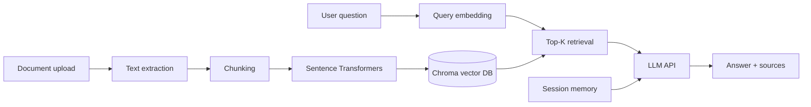

# Semantic Search Engine with RAG

Portfolio-ready AI app: users upload documents, ask questions in natural language, and get answers grounded in their own data.

## Architecture



**Stack:** Python, FastAPI, Sentence Transformers, Chroma, OpenAI-compatible LLM API.

## Features

- Upload PDF, DOCX, TXT, MD, CSV
- Configurable chunk size / overlap
- Cosine similarity search over embeddings
- RAG answers with cited source chunks
- Per-session dialog memory (last turns)
- User preferences (tone, language) injected into prompts

## Quick start

```bash
cd "/Users/egorkuzmenko/Desktop/CV/Semantic search"
python3 -m venv .venv
source .venv/bin/activate
pip install -r requirements.txt
cp .env.example .env
# Edit .env: LLM_API_KEY, LLM_BASE_URL, LLM_MODEL
uvicorn app.main:app --reload --port 8000
```

Open [http://127.0.0.1:8000/docs](http://127.0.0.1:8000/docs) for Swagger UI.

### Ollama (local LLM)

```env
LLM_API_KEY=ollama
LLM_BASE_URL=http://127.0.0.1:11434/v1
LLM_MODEL=llama3.2
```

## API

| Method | Path | Description |
|--------|------|-------------|
| POST | `/documents/upload` | Upload and index a file |
| GET | `/documents` | List indexed documents |
| DELETE | `/documents/{document_id}` | Remove document from index |
| POST | `/chat` | Ask a question (RAG) |
| GET | `/sessions/{session_id}` | Session stats and preferences |
| PATCH | `/sessions/{session_id}/preferences` | Update tone / language |

### Example

```bash
curl -F "file=@report.pdf" http://127.0.0.1:8000/documents/upload

curl -X POST http://127.0.0.1:8000/chat \
  -H "Content-Type: application/json" \
  -d '{"question": "What are the main risks?", "session_id": "demo"}'
```

## Project layout

```
app/
  main.py              # FastAPI entrypoint
  config.py            # Environment settings
  rag/                 # Chunking, embeddings, Chroma, ingest
  services/            # LLM client, session memory
  api/                 # HTTP routes
  models/schemas.py    # Pydantic models
```

## What this demonstrates for employers

- End-to-end RAG pipeline (ingest → embed → retrieve → generate)
- Vector search and embedding models in production-shaped code
- REST API design with FastAPI
- LLM integration via standard OpenAI-compatible APIs
- Session memory and lightweight personalization
